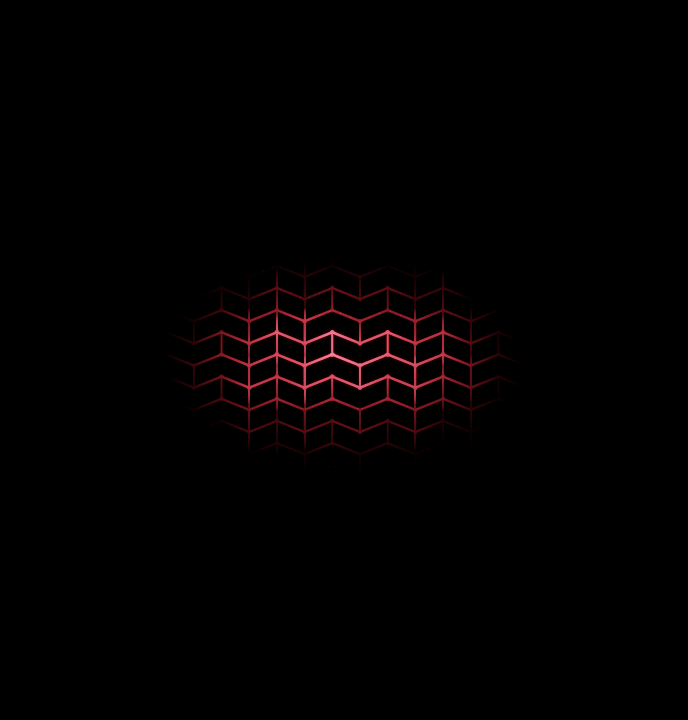
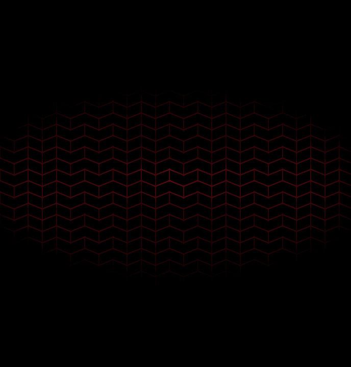

# Native lens and panel verification

The optimized lens preserves the baseline's synthetic HDR image at 1280 × 720:
the largest absolute RGB error is **0.000024319**, and the largest case RMS error
is **0.00000010990**. No pixel in any case exceeds 0.001 absolute HDR error.
Identity and motion-only cases match exactly; alpha matches exactly throughout.
The high profile still uses 32 aperture samples and 8 motion samples; auto uses
20 and 6. These are shader equivalence measurements, not site FPS measurements.

## Method

`tools/native-optics-check.py` extracts the original lens from commit
`23cc76ab88ca2bffd8a33525e18fb70225b69438` and the current lens from the actual
`RoomOptics` material. Both exact fragment sources run against the same textures
and camera uniforms in the installed EGL 1.5 / GLES 3.20 llvmpipe context. The
native prefix includes Three's highp float, integer, and sampler precision.

The camera has a 42° field of view, a 1280:720 aspect, and near/far planes at
0.08/100 metres. Inputs contain sharp silhouettes at 0.65, 2, and 4 metres,
in-focus detail at 12 metres, and saturated red/white HDR dots at 36 metres.
The input color uses bilinear RGBA16F sampling. Sampled depth uses nearest R32F
values quantized to 24 bits; object velocity uses nearest RGBA16F. RGBA32F
readback measures differences before output quantization or tone mapping.

| Case | Maximum absolute HDR error | RMS HDR error |
| --- | ---: | ---: |
| Identity, high | 0 | 0 |
| Depth of field, focus 12 m, high | 1.02073e-6 | 1.35497e-8 |
| Depth of field, focus 12 m, auto | 6.43730e-6 | 5.04767e-8 |
| Depth of field, focus 4 m, high | 2.43187e-5 | 1.09901e-7 |
| Depth of field + camera motion, high | 6.18398e-7 | 1.27793e-8 |
| Camera motion only, high | 0 | 0 |
| Depth of field + object motion, high | 1.02073e-6 | 1.35618e-8 |

The source snapshots in this directory and hashes in `report.json` identify the
tested shaders. The probe does not store large float fixtures; it regenerates
them deterministically. The full output also includes baseline/current PNGs
and difference maps for each case.

## Actual panel material

All five panel shaders were constructed through the production mutation order:
base display → hologram → portal → identity → panel energy. All compiled and
linked successfully, and both idle and active draws produced finite pixels.
`panel-0.raw.frag` preserves the complete combined fragment source; all five
share that source, with different panel uniforms.

The two retained PNGs show a released 0.4-strength center impulse at 0.2 and
0.6 seconds on the actual panel energy field. Each image is the active material
minus an otherwise identical idle material, computed in raw HDR. The viewport
preserves the physical panel aspect (0.95565; 688 × 720 pixels). A display-only
ACES approximation and sRGB conversion make the added light visible on black;
there is no brightness multiplier. These are shader fixtures, not site
screenshots. The 0.2-second image shows continuous bright chevrons around the
input, and the 0.6-second image shows the wider, dimmer afterglow.





## Reproduce

Run from `dxrkths` with the installed project dependencies, Python NumPy/Pillow,
and an installed EGL/GLES provider:

```sh
python tools/native-optics-check.py \
  --baseline 23cc76ab88ca2bffd8a33525e18fb70225b69438 \
  --output /tmp/dxt-native-optics
```

The default viewport is 1280 × 720. Native rendering is optional tooling; exit
77 means the required EGL compiler is unavailable. The script does not install
software, launch a browser, or change graphics configuration. Keep the baseline
commit explicit when reproducing after the optimization is committed.

## Limits

This validates the actual custom shader fragments and their numeric behavior
on a synthetic texture fixture. It does not render the full showroom, exercise
browser WebGL state or MSAA resolves, or measure performance on the user's GPU.
No browser appearance or FPS claim follows from this probe. Timings from the
earlier provisional run are intentionally excluded from the retained evidence.
