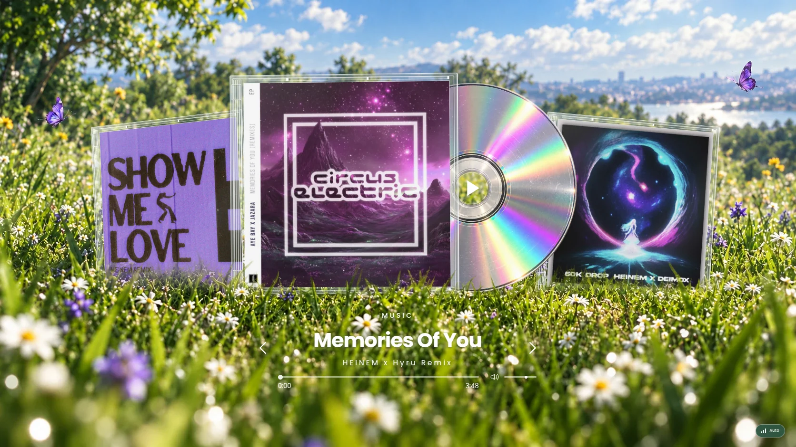

# HEINEM 1.1 — approved meadow and CD composition

## Approved scope

The user approved [this concept](reference/music-approved.webp) and requested a faithful interactive implementation. Preserve the existing portrait and hero identity, continue the meadow through the music section, replace the separate music dashboard with three jewel cases and a silver CD, remove the extra About/Contact/CTA sections, and retain real playback controls. The initial arrangement is Show Me Love on the left, Memories Of You in front, and MHA 50K Drop on the right.

The same request includes sharper bubble refraction, one continuous pointer deformation shared with the letters, localized luminous highlights, smoother scrolling and a fixed disc pivot. Changes remain bounded by existing graphics profiles, reduced motion, hidden/offscreen suspension and lazy media initialization.

## Implementation record

- The approved concept is the composition reference, not a flattened replacement for the interactive page.
- The landscape is a shared fixed scenic layer beneath both sections. The original hero transitions through a soft grass boundary into it; no opaque content panel interrupts the scene.
- Jewel cases use the actual release artwork with lightweight glass edge details. The silver disc uses an isolated photographic material with transparent exterior/aperture; the rotor and stationary hub/play target are separate. CSS corrects the generated material's small center offset and transparent margin.
- Carousel order is Memories → MHA → Show, making the visible left/right cases agree with Previous/Next. Selecting a sleeve does not start playback by itself.
- Bubble and text share one pointer field; glyph geometry is cached outside the render loop. Highlight glow is localized, without a second scene render or full-screen bloom chain.
- Desktop wheel interpolation uses the real document scroll position. Touch, keyboard, nested scrollers and reduced-motion preferences retain native control. Tab/Shift+Tab cancel pending interpolation before focus navigation.

## Verification

TypeScript and the production build pass with 25 graphics, player and scroll tests. The complete local browser suite passes all 15 checks, including glyph deformation, disc pivot, graphics controls, mobile layout, fallback and media state. A focused follow-up also confirms the center of the CD is the actual hit target in all four tested viewports. See [VALIDATION-1.1.md](VALIDATION-1.1.md) for the environment, counters, publication status and external audio limitation.

The visual review compared the implementation with the approved concept at 1672 × 941, then checked 1440 × 900, 390 × 844 and 320 × 780. Iteration corrected the side-case perspective, title weight and spacing, synthetic disc material, foreground occlusion, mobile grass crop and the exposed/inverted hero edge. The live interface retains the real artist covers, so their original lettering is not replaced by the concept's generated interpretation.

[Mobile composition](evidence/meadow-mobile.webp) · [Approved concept](reference/music-approved.webp)
